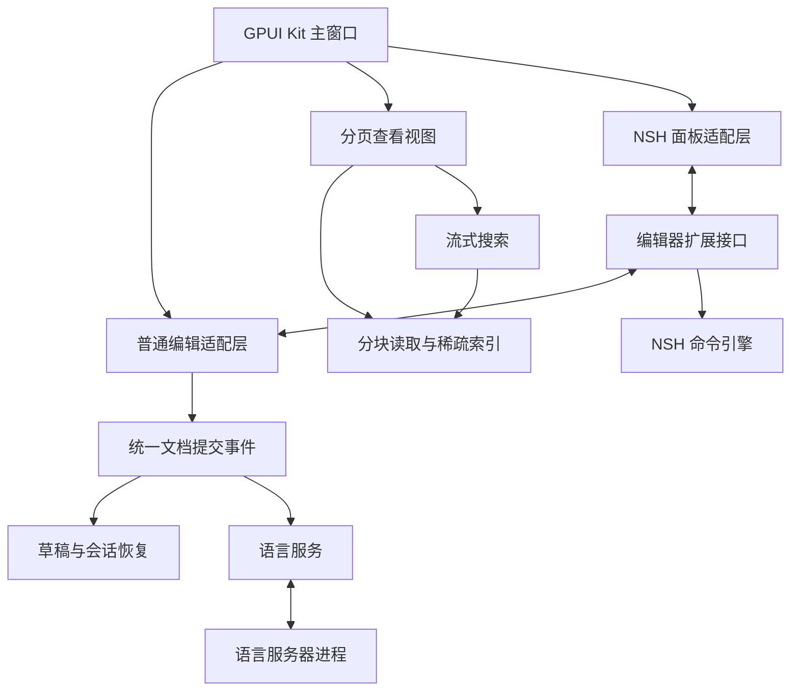

# Rust GPUI 轻量编辑器整体设计与 Agent 实施交接

版本：1.0  
设计基线日期：2026 年 11 月 5 日  
用途：交给开发 Agent 实现，作为需求、架构、任务顺序与验收的共同基线。  
当前状态：产品方向与架构已讨论；尚未交付本项目代码，也未完成本项目的构建、跨平台交互或性能测试。本文的 API、模块名和参数是实施设计，除明确引用的上游接口外，不代表现成库已经提供。

## 0 接手 Agent 先读

项目目标是一个轻量、启动快、现代界面的桌面文本编辑器：日常功能向 Notepad++ 对齐，基础编辑体验参考 Sublime Text 和 VS Code，突出超大文件查看与检索、可靠的未命名草稿恢复、可扩展能力。

执行顺序：

1. 阅读本文的决策表、文档权威约束和 P0 任务。
2. 检查实际仓库及已有开发规范。当前交接不包含既有仓库地址，不要假定已有实现。
3. 先完成依赖和原生窗口原型，记录真实构建结果；同时建立统一文档事务接口。
4. 优先交付正常编辑、临时文档恢复和大文件查看检索，再补全语言与扩展能力。
5. 每个阶段提供可运行产物、验证记录和剩余问题。没有实测的项目标记“待验证”，不能把官网能力或源码示例写成项目已完成能力。
6. 常规实现选择可按本文件推进；改变产品目标、放弃已确定核心需求或增加必须联网的使用条件时，应说明影响并取得用户决定。

### 0.1 决策状态

| 项目 | 状态 | 执行要求 |
| --- | --- | --- |
| 主语言 | 已确定 | Rust |
| 主窗口和通用 UI | 已确定 | GPUI Kit，统一使用其导出的 GPUI API |
| Scintilla 的作用 | 已确定 | 借鉴大文件处理策略；不移植其渲染体系，不实现 Scintilla 二进制兼容 |
| 普通文本编辑区 | 首选实现路线 | Kit Editor；通过自己的适配层使用 |
| NSH Editor | 对比候选 | 可参与 P0 对比；只选择一个默认普通编辑后端 |
| 扩展开发语言 | 建议默认 | TypeScript；面板用 TSX；语言规则和主题尽量声明式 |
| 扩展运行时 | 优先验证 | NSH engine 和 AppView；不视为已验证的生产组合 |
| 超大文件 | 已确定架构方向 | 独立分页查看与流式检索，首版只读 |
| 文档与会话 | 已确定架构方向 | 文档 ID 独立于路径；草稿默认可恢复 |
| 性能 | 待实测 | 第 15 节是工程目标，不是已经实现的指标 |

### 0.2 默认假设

平台范围由用户明确；其他默认约定用于直接开工，不代表用户已经逐条承诺：

- 用户已明确：交付平台仅为 macOS 和 Windows x64。Windows ARM 不在范围内。
- macOS 先以 Apple Silicon 作为构建、交互和性能验证基线；Windows 在真实 x64 系统验证。macOS Intel/x64 的产物策略与最低系统版本在 P0 中确认并记录，不把未测试的目标写成已支持。Linux 不列入产品实现与发布任务。
- “关了再起来恢复”首先指退出应用后恢复当时打开的标签和未保存内容。主动关闭的标签进入“最近关闭”，可手动恢复，下次启动不强制全部重新打开。
- 第一版超大文件以查看和检索为主。超大文件任意位置编辑、全量替换和超大文档 LSP 不属于首版承诺。
- 不要求兼容 VS Code、Notepad++ 或 Sublime 的既有二进制插件。
- 初期不实现完整 IDE、终端、调试器、协作编辑或必需的 AI 功能。
- 基础编辑、草稿恢复、内置扩展可离线使用。语言服务器和扩展更新可以通过独立离线包交付。

## 1 产品范围与优先级

### 1.1 必须形成的用户闭环

1. 新建多个未命名文档，直接输入和粘贴，退出后重新打开，文本和标签次序恢复。
2. 打开普通源码或文本，进行选择、搜索、替换、多光标操作、撤销和保存。
3. 打开远大于可用内存的日志，快速看到首屏，滚动或跳转，执行可取消的检索。
4. 在普通 JSON 文档或选区上执行插件命令，修改作为一个可撤销事务提交。
5. 打开图片，进入图片预览视图。
6. 安装包自带基础语言和工具扩展；用到时激活，无须用户先搭建开发环境。

### 1.2 功能分期

| 能力 | 首个可用版本 | 后续增强 |
| --- | --- | --- |
| 文件与标签 | 新建、打开、保存、另存为、最近文件、拖入、关闭恢复 | 多窗口、工作区历史、复杂分屏 |
| 编辑 | IME、选择、复制粘贴、撤销重做、缩进、多光标和矩形选择验证 | 宏、复杂代码片段、更多编辑命令 |
| 查找替换 | 普通文档字面量与正则，替换预览和事务 | 文件夹搜索、跨文件替换 |
| 超大文件 | 分页只读、字面量流式搜索、字节定位、后台行索引 | 有预算的逐行正则、日志跟随、更强索引 |
| 草稿 | 未命名及已修改文档内容恢复、标签顺序、基本视图位置 | 跨启动完整撤销栈、历史版本管理 |
| 编码与换行 | UTF-8、BOM、统一 LF/CRLF；保真失败时只读 | UTF-16、GB18030 等旧编码、混合换行无损编辑 |
| 语言 | 基础高亮、语言选择、注释/括号/缩进配置 | Tree-sitter 结构能力、语义着色 |
| 扩展 | 内置 JSON 工具、版本化 SDK、NSH 候选宿主 | 安装管理器、第三方分发、更多查看器 |
| LSP | 后续阶段接一个服务器验证补全、诊断、跳转 | 多语言、多工作区、代码操作 |
| 图片 | 常见格式只读预览、缩放、尺寸信息 | 大图分块、更多格式和元数据 |
| UI | 现代、克制、深浅主题、键盘优先 | 高级动效、更多主题和布局 |

“功能对齐”按此矩阵推进，不能把第一版描述成完整复刻 Notepad++ 或 VS Code。未支持的编码或操作必须准确暴露状态，不能静默损坏文件来满足功能清单。

## 2 已核实的上游事实与采用条件

### 2.1 GPUI Kit

GPUI Kit 当前通过统一依赖入口导出 GPUI、基础层、组件和资源；默认使用固定的上游 GPUI 快照，也提供 gpui-fast 选择。[S01]

Kit Editor 已有语言配置、补全接入、多光标、列选择和高亮等能力。[S02] 其编辑状态持有 Rope、显示映射、撤销管理器及文档版本，并提供文本修改事件。[S03]

工程约束：

- UI 类型统一来自同一套依赖。不能随手再引一份不同来源或版本的 GPUI。
- 使用现成 Editor 不意味着可以直接替换其内部 buffer。
- 不把 Kit 的普通 Editor 视为分页文件查看器。
- 先通过适配层接入，再决定是否需要最小上游补丁或替换编辑后端。

### 2.2 NSH

NSH 提供 Rust/TSX 应用模型、独立引擎线程、GPUI 嵌入及宿主通信；TSX 运行在引擎线程的 JS VM，UI 接收批量提交。[S05][S06]

官方 embed-gpui 示例展示了 Kit 控件与多个 NSH AppView 共存、主题和状态同步、焦点切换、宿主弹层、Rust 服务及原生组件嵌入。[S07]

需要明确以下采用条件：

| 事项 | 已知情况 | P0 要完成什么 |
| --- | --- | --- |
| GPUI 后端 | NSH 当前 GPUI 路线基于 GPUI Fast | 双方用于 UI 互操作的 gpui-fast / gpui-fast-platform 类型来自统一、兼容的 package、source 和解析版本 |
| 示例版本 | 官方混合示例引用 Kit 0.7.3 + gpui-fast | 不能直接宣称已验证 Kit 0.9.0 + NSH 0.4.0 |
| 当前候选 | Kit 0.9.0、NSH 0.4.0 | 编译、IME、焦点、生命周期和 release 测量 |
| 运行隔离 | 默认同进程，独立引擎线程与 VM | 验证脚本错误隔离；不宣称进程崩溃隔离 |
| 可选依赖 | nsh-platform-gpui 当前默认 features 为 js、webview | 按需关闭该 crate 的 WebView feature，记录剩余依赖成本 |
| API 稳定性 | 0.4.0 在 2026-11-04 发布，存在不兼容变更 | 固定 tag/版本和锁文件，SDK 通过适配层隔离 |

以上版本及集成条件来自官方配置和发布资料。[S08][S11][S12]

NSH 的 HostChannel 已具备参数、请求和事件桥；底层 Engine 的测试存在无窗口 JS 运行路径。[S09][S10] 因此，普通命令插件可验证 headless engine，带 UI 的插件可验证 AppView，不必为纯命令强造隐藏窗口。

### 2.3 Scintilla 的借鉴范围

借鉴宽偏移、减少样式开销、后台分块装载、限制布局缓存与软换行等策略。Scintilla 的 Loader 仍会构造完整文档，不能将它等同于固定内存预算的按需读盘后端。[S04]

### 2.4 依赖与可复现构建

- 固定 Rust toolchain、Cargo.lock、JS 构建工具和目标平台。
- 依赖使用已选 release 或明确 commit，避免浮动 main。
- 保存实际编译命令、目标架构、系统依赖和必要 feature。
- NSH 的“可选编译”与“按需创建运行实例”分别实现。
- 开启 NSH UI 时统一选择兼容的 Fast 后端，禁止窗口内混用两套不兼容 GPUI 类型。
- 依赖树可以存在构建时需要的 upstream GPUI 包；检查重点是相互传递的 UI 类型来自同一个兼容 Fast 实例，不能仅凭出现 gpui-pre 就认定失败。
- 不为追随示例而静默降低 Kit 版本；若采用不同组合，在 ADR 中记录 API 和功能影响。
- 基础应用运行不需要 Node/npm。插件的构建与运行依赖在开发文档中单列。
- 不在构建过程中依赖未记录的自动下载；离线构建交付时整理依赖缓存、vendor 或内部镜像步骤。

## 3 总体架构与模块边界



图中的 NSH 引擎默认仍处于应用进程内，各引擎使用自己的线程。LSP 服务器是外部进程。若未来采用独立扩展进程，必须另行实现 IPC、监督、终止和重启；不能直接把 AppView 移到另一个进程后假定界面集成不变。

### 3.1 逻辑模块

| 模块 | 责任 |
| --- | --- |
| app-shell | 窗口、标签、菜单、主题、命令入口、恢复布局 |
| document-domain | 文档 ID、版本、元数据、模式、请求和提交事件 |
| editor-adapter | 普通 Editor 生命周期、编辑、撤销事务和事件归一化 |
| paged-document | 文件范围读取、解码、缓存、稀疏行索引和文件变化 |
| search-service | 文档/文件检索、取消、结果分页和内存预算 |
| recovery-service | 草稿快照、增量日志、恢复、会话布局和失败处理 |
| extension-api | 与运行时无关的命令、文档、语言能力及面板协议 |
| extension-host | 激活、身份、调度、资源额度、订阅和卸载 |
| nsh-adapter | Headless engine、AppView、宿主桥、主题和焦点 |
| language-services | 高亮配置、LSP 进程、同步、坐标转换、过期结果处理 |
| file-viewers | 图片等非文本资源的加载、缓存与显示 |

逻辑模块不必逐个建立 Cargo crate。首轮拆分 UI 与纯数据/后台服务即可，避免生成大量无实现的空 crate。

### 3.2 建议仓库组织

| 建议路径 | 内容 |
| --- | --- |
| apps/editor | 主程序、GPUI 适配、NSH UI 适配 |
| crates/editor-domain | 公共 ID、版本、能力、协议及事务定义 |
| crates/editor-storage | 文件读写、分页缓存、会话与恢复存储 |
| crates/editor-search | 流式搜索、普通文档搜索接口 |
| crates/editor-extensions | 插件管理、headless NSH、宿主调度 |
| crates/editor-language | 高亮与 LSP 公共服务 |
| packages/editor-sdk | TypeScript 类型和宿主调用封装 |
| extensions/builtin-json | JSON 工具扩展及清单 |
| resources/languages | 语言配置、语法和主题资源 |
| tests/fixtures | 小型正确性用例 |
| tools | 大文件生成、基准采集和故障注入工具 |
| docs | 架构决定、实施状态、构建、测试、性能及已知限制 |

这些是建议建立的路径，并非交接时已经存在的文件。

## 4 文档模型与唯一权威状态

### 4.1 文档不是路径

为每个文档创建稳定的 DocumentId。未命名文档具有虚拟 URI，例如 untitled: 加 UUID；路径可以为空。另存为改变文件关联，不应默认改变文档 ID。

区分：

- Document：内容、版本、来源、编码、保存状态和能力。
- View：光标、选择、滚动、折叠、缩放以及使用的查看器。
- Workspace/Window：文档集合、标签次序、分屏和焦点。
- Session：上述可恢复状态的持久表示。

多个视图可指向同一文档，不能为每个标签页产生独立的可编辑内容副本。

### 4.2 普通文档的文本权威

首轮使用 Kit Editor 时，EditorState 是普通文档唯一的可变文本与撤销/重做权威。

document-domain 管理 ID、版本、来源、模式、保存状态和事务协议；它此时不再维护第二份可编辑 Rope，也不建立第二个并行撤销栈。

统一变化路径：

1. 用户输入或宿主命令进入 editor-adapter。
2. Editor 实际提交修改。
3. adapter 将该修改批次归一化为一个事务，分配版本并发布提交事件。
4. 恢复、语言和扩展服务消费此事件。
5. 插件修改也经过同一入口，形成一次撤销操作。

严禁 applyEdits 手工记一次日志，随后监听 Editor 事件再记一次。事务 ID、批次边界和唯一提交源必须明确。Kit 的增量事件包含修改及关联快照，可以作为适配起点。[S03]

允许不可变快照、语言服务器镜像、恢复快照和有预算的缓存。它们是派生数据，不接受竞争性的独立修改。

若最终需要自研文本引擎，应同时替换编辑后端和其视图接入方式。禁止以“核心一份 Rope + Editor 一份 Rope + 每次 set_value 全文同步”作为长期架构。

### 4.3 文档类型与能力

建议区分：

- EditableText：正常文本编辑。
- PagedText：大文件只读查看。
- BinaryPreview：图片等原生查看器。

RecoveryDraft 表示恢复来源或待确认状态，不是第四种互斥的内容后端。可编辑的恢复草稿仍使用 EditableText；原路径冲突、丢失或待确认时，先保留为独立草稿，不能自动覆盖源文件。

能力由宿主产生，例如 readableRanges、editable、fullSnapshot、formatDocument、languageServices、searchLiteral、searchRegex、lineIndexComplete。插件不能仅凭文件扩展名推定能力。

模式选择同时考虑字节数、行数估计、最长行、编码、可用内存、用户设置和后端能力。首次只读取有界前缀来显示首屏，不能为了决定模式先扫完整个文件。

### 4.4 坐标与版本

- 普通文本内部规范坐标：当前文档 UTF-8 文本的字节偏移，范围为半开区间。
- 分页文件规范坐标：原始文件字节偏移，必须标明 sourceGeneration。
- 行列、视觉列、UTF-16 code unit、字符和字节偏移是不同概念。
- JS 协议中的 u64，包括 revision、byte offset 和 length，使用十进制字符串，避免经过 JS Number 丢失精度。
- 普通文本偏移不能直接用于非 UTF-8 原始文件读写；解码适配层负责映射。
- LSP 的位置编码协商和转换集中实现，不能散落到各插件。
- 编辑边界必须位于合法字符边界；光标移动按用户可见字符处理，不能在 UTF-8 字节或代理对中间截断。
- CRLF 是一个逻辑换行，替换和回写不得意外分离其两个字节。

## 5 普通编辑与文件保真

### 5.1 第一批编辑能力

验证中文 IME 预编辑和提交、组合字符、Emoji、双向文本基本显示、鼠标选择、键盘选择、多光标、矩形选择、复制粘贴、缩进、撤销重做。

IME 未提交文本不应被当作最终文档事务反复持久化。组合输入完成后，事务、光标和撤销应一致。

### 5.2 编码和换行

首轮保证 UTF-8、UTF-8 BOM、统一 LF 和 CRLF 文件。打开并无修改地保存，应保持字节保真；修改保存则保持原编码、BOM 和约定的换行策略。

UTF-16、旧编码或混合换行如尚未实现保真，先显示明确的只读/转换能力，不得隐式转码保存。转换编码和统一换行必须是用户可识别的命令。

若选择 NSH Editor，需要特别处理其换行规范化，以及当前 Change 路径的全文字符串物化。它的 Rust Buffer 和控制器源码已体现这些行为。[S13][S14] 此事实不代表 Kit 具有相同行为，两个候选分别验证。

混合换行可后续通过每行换行元数据实现无损编辑。在此之前，不能把内部统一 LF 的文本直接写回并宣称保真。

### 5.3 原子修改契约

一批编辑必须满足：

- 指向存在、可编辑的文档和当前 baseRevision。
- 所有范围在同一修改前快照中解释。
- 范围合法、边界有效、彼此不重叠。
- 同一位置的多个插入，首版要求调用方先合并，避免顺序歧义。
- 全批验证后才应用；失败时不得留下部分修改。
- 一批格式化或多选转换形成一个撤销事务。
- 提交后恰好推进一次宿主文档版本并发布一次统一事务事件。
- 用户在插件计算期间继续输入时，旧版本结果被拒绝或重新计算，不能覆盖新输入。

编辑器组件若无法提供可靠事务边界，优先做最小接口补丁并记录维护方式。不能用重新设置整个文本来伪装正常编辑事务。

## 6 超大文件查看后端

### 6.1 首版目标

大文件路径以只读查看、流式检索、定位和复制有界选区为主。打开文件、第一屏显示和用户输入响应，不等待全文读取、解码、语法分析或完整行索引。

普通编辑和分页查看共享标签、命令与搜索结果体验；底层存储不同。

### 6.2 读取和缓存

- 使用支持显式偏移的后台文件读取接口，缓存按原始字节区间组织。
- 首版优先有界 ReadAt/分块读取；mmap 如采用，必须处理外部截断和失效风险，不能仅因映射虚拟地址就宣称内存有界。
- 缓存具有全局与单文档预算，结合 LRU/邻域预读。
- 高频滚动请求合并，只保留最新视口优先级；过期预读可取消。
- 解码只覆盖视口和小幅邻域，保存跨块编码状态及字节映射。
- 后台读取、解码和索引不能占用 UI 线程。
- 多个大文件不能各自无限占用一份“默认缓存”。

### 6.3 稀疏行索引

初始按字节导航，后台渐进建立换行计数与定位锚点。索引按字节跨度或行跨度抽样，并有独立内存预算；必要时写入可重建的磁盘缓存。

不为每一行永久保存一个 64 位偏移后再声称对任意行数内存有界。极短行、数亿行文件必须进入验收集。

索引未完成时：

- 可以显示当前已知行号与进度。
- 未知总行数、绝对行号或百分比不得伪装精确。
- 跳到尚未索引的行是可取消的后台任务。
- 搜索命中先以字节位置可定位，行号可随后补充。

### 6.4 超长单行

单行可能远大于普通文件。不得先读取、解码或 shaping 整行，再裁剪出视口。

首版对超长行采用有界连续片段显示与字节定位，限制单次解码和布局长度。必要时显示“连续片段”状态。已知时显示真实逻辑行号；索引尚未覆盖时显示字节位置与待索引状态，不能为了补齐行号阻塞视口读取。片段换行不得计为新的文件逻辑行。

大文件默认关闭软换行、完整语法分析、全文格式化和普通 LSP。复杂 Unicode 布局的有界实现范围必须记录，不能通过截断造成假定位。

### 6.5 外部文件变化

记录打开文件的身份、大小、时间信息和 sourceGeneration；读取、索引和搜索都绑定该代。

- 检测替换、截断或不兼容修改后，使旧缓存、索引和结果失效。
- 读取错误进入可恢复状态，不让 UI 崩溃。
- 追加日志可以作为后续专门模式处理；首版不把任意修改当作安全追加。
- 稳定文件上的检索要求正确；外部并发原地写入时，普通文件句柄不等于不可变快照。发现变化应取消或标记结果失效，不宣称一致性快照。
- 文件身份和时间戳不是任意场景下的内容证明。需要强一致时，另行提供受控快照或明确使用约束。

## 7 搜索与替换

### 7.1 共用查询模型

查询至少包含 queryId、目标 DocumentId/sourceGeneration、搜索类型、编码策略、大小写规则、范围、结果上限与取消令牌。结果包含原始定位坐标、匹配长度、有限上下文及所属版本。

旧查询的批次不能混入新查询。结果列表采用虚拟化，显示“已找到数量”与“完整计数是否完成”。

### 7.2 大文件字面量搜索

首版采用顺序流式扫描与全局搜索游标。可以使用跨块状态机，或对已编码的固定字面量保留足够的边界数据；carry 方案输出本次新完成的匹配，并保持全局一致的非重叠语义。

首版默认使用 UTF-8 字面量、区分大小写、从左到右非重叠匹配。例如 aaa 在 aaaaa 中只产生 [0, 3) 一个命中；更换读取块大小不能改变此结果。空查询不启动扫描，返回空结果；超过查询长度上限返回明确错误。大小写不敏感、其他编码或重叠模式如需开放，应分别增加协议选项和正确性验证。

正确性要求：

- 匹配跨读取块、UTF-8 编码边界和 CRLF 边界时不能漏报。
- 串行 carry 方案不能把“起点位于前一块”作为丢弃新完成命中的理由；通过全局游标避免重复。按起点归块仅适用于明确带右侧重叠读取及结果归并的分块方案。
- 结果上下文有长度上限；长行不导致提取整个行。
- 先分批返回，再继续扫描。
- 取消、文档关闭和源文件变化能终止后续工作。
- 命中数量达到展示上限时，首版停止扫描并返回 truncated=true、countExact=false；不能把已收集数量显示为精确总数。继续计数或磁盘结果分页属于另行实现的能力。
- 字面量查询遵守上面的空查询与长度规则；正则零长度匹配必须按合法字符边界推进，避免死循环，并记录文档末尾匹配语义。

若 UTF-16 搜索尚未支持，应明确限制，不把 UTF-8 字节搜索直接套在 UTF-16 文件上。大小写折叠可能改变长度，映射和边界语义须独立验证。

### 7.3 正则范围

普通文档先支持有资源边界的正则搜索和替换。

大文件初期仅承诺字面量搜索。后续可以增加逐行正则，但必须明确最大处理行长度及不支持的模式。不能使用固定 4 KiB 或 64 KiB overlap 来声称支持任意跨行、无界长度正则。

多行正则只有在引擎和流式语义能证明正确时才开放。超出能力应返回明确错误，不能静默截断后返回“无匹配”。

### 7.4 替换

普通文档替换绑定快照版本，先生成 edits、校验，再作为一个事务应用。大文件首版不做原位全量替换。未来大文件转换应输出新文件，并单独设计空间预算、取消和发布流程。


## 8 草稿与会话恢复

### 8.1 用户可见语义

未命名文档从创建起具有稳定 ID；输入不要求先选磁盘路径。

- 退出应用：恢复当时打开的标签、未保存内容、当前文档和基本视图位置。
- 主动关闭标签：从“下次自动打开”列表移除，内容保存在“最近关闭”。
- 明确丢弃：先持久化丢弃状态，再清理内容，避免旧日志重放后复活。
- 未保存草稿不得作为普通缓存自动淘汰。空间不足时报告恢复保护失败，保留内存内容。
- 草稿持久化不等于保存到原文件，不能因此清除 dirty 标记。
- 首版不承诺跨启动完整撤销历史。恢复文本、保存状态和会话布局优先；恢复日志不直接等同于用户撤销栈。

### 8.2 三个版本水位

分别维护 visibleRevision、queuedRevision、durableRevision：

- visibleRevision：用户已经看到的版本。
- queuedRevision：已排入后台持久化队列的版本。
- durableRevision：恢复库已确认持久提交的版本。

正常退出先停止接收新的编辑，提交最后一批修改和会话状态，再退出。插件 deactivate 不能阻塞或决定草稿是否落盘。

异常终止恢复到最后完整提交。尚在内存、未完成提交的最后输入不承诺恢复；不能对外声称“永远零丢失”。存储失败时，持久水位不得虚假前进。

### 8.3 恢复存储方案

第一版建议一个本地 SQLite 数据库，由单独后台服务管理：

- WAL 模式，使用经过验证的同步策略；需要耐久提交语义时采用 FULL 等合适配置。
- 编辑事务批量提交，UI 不直接刷盘。
- SQLite WAL checkpoint 与“文档内容快照”分别命名和管理。
- 数据库放在本机应用数据目录，不放在网络共享目录。
- 大文件只读视图存位置和来源信息，不复制完整源文件进恢复库。

SQLite 的 WAL、同步级别和本地文件系统约束以官方文档为准。[S20][S21] 进程强杀测试不等价于已经验证所有真实掉电与存储设备故障。

建议表组：

| 表组 | 关键内容 |
| --- | --- |
| documents | DocumentId、URI、路径、标题、编码、换行、dirty、打开/关闭/丢弃状态 |
| document_checkpoints | 快照 ID、文档 ID、版本、总长度、内容校验和、complete 状态 |
| checkpoint_chunks | 快照分块、顺序、分块内容与校验 |
| edit_transactions | 事务 ID、基础版本、新版本、完整 edits、顺序与校验 |
| recovery_heads | 当前可用快照及 durableRevision |
| windows_views | 标签顺序、活动标签、视图、光标与滚动位置 |
| save_intents | 保存的版本、目标路径、输出指纹、阶段与结果 |

表设计可以调整，但必须满足事务完整性、可确定重放、迁移版本与单文档恢复失败隔离。

### 8.4 自包含恢复点

有名文件出现未保存修改后，不能只保存“路径 + 基于原文件的 edits”。原文件可能被外部修改、移动或删除。

建立可独立恢复的基线或完整快照，再记录后续修改：

1. 获取带版本号的不可变文本快照。
2. 后台生成分块内容与校验。
3. 分块可先写入暂存状态；只有完整性校验通过，才发布为有效快照。
4. 通过一个数据库事务切换 recovery head，保留该版本之后的日志。
5. 提交成功后再清理旧快照与被覆盖日志。

同一文档首版最多运行一个快照生成任务；发布事务仍检查快照版本不倒退、文档生命周期代际和丢弃状态。迟到的快照或编辑任务不得重建已经丢弃的 recovery head。发布后的快照与保留日志必须共同覆盖已确认的 durableRevision。

首次恢复基线尚未建立时，不得确认其后的日志已经构成可恢复的 durableRevision。可以合并尚未持久的修改，先写一个自包含快照，再进入增量模式。

生成版本 S 的快照时继续发生的修改，必须保留为 S 之后的事务。不能因为快照完成就删除更新的日志。

### 8.5 退出、异常与迁移

- 退出时等待已接受编辑的必要持久提交，不等待无关 LSP 或插件任务无限结束。
- 数据库写入失败、磁盘满或目录不可写时，明确指出恢复保护失败，保留文档并提供另存机会。
- 一份损坏草稿不应阻止其他草稿恢复。
- 丢弃状态必须与日志清理有明确顺序。
- 数据结构带 schemaVersion；迁移前有可恢复的备份或事务策略。
- 升级不得清空未知旧版本恢复数据后假装初始化成功。
- 恢复文件对应的原路径已变化时，先恢复独立草稿；不自动覆盖磁盘文件。

## 9 保存与外部冲突

恢复库和用户目标文件不能构成同一个跨文件原子事务。保存必须记录捕获版本和阶段。

建议流程：

1. 捕获不可变文档版本 R，确认目标路径、编码及可识别的外部变化。
2. 在恢复库记录 save intent，草稿继续保留。
3. 在目标所在目录/文件系统创建临时文件。
4. 流式编码输出版本 R；不可表示的字符或 I/O 失败直接终止保存。
5. 同步临时文件，记录输出指纹及 prepared 阶段。
6. 使用平台合适的替换操作发布目标文件，并处理必要的目录耐久步骤。
7. 提交 savedRevision = R、路径及新来源信息，完成 save intent。

禁止“先删除原文件，再重命名临时文件”。Windows 需验证 ReplaceFileW 等平台路径和错误恢复；不能只用一段跨平台伪代码宣称替换、权限和耐久性全部一致。[S22]

保存期间允许继续输入。磁盘保存的是捕获内容 R，完成后将它标记为保存点；dirty 依据当前内容是否等于保存点判断，单调 revision 只用于版本和过期检测，不能作为唯一的 dirty 判据。若当前内容不同，仍保留 dirty 和后续恢复内容；若修改后又撤销到保存内容，应正确回到已保存状态。优先使用组件历史保存点或可验证的内容身份，避免每次键入全文比较。另存为不改变 DocumentId。

恢复库不可用时，仍允许用户显式保存或另存为：捕获内存版本并执行目标文件的安全写入流程，同时保留“恢复保护失败”状态；不能因无法记录 save intent 而阻止抢救保存。这一降级流程不宣称具有完整的跨崩溃保存意图追踪。若目标文件已经成功发布，但最后的恢复库确认失败，分别报告“文件已保存”和“恢复记录更新失败”，不能误报为目标文件根本未保存。

外部冲突、只读文件、权限、符号链接、硬链接、杀毒或索引软件持有句柄等行为应形成明确策略和平台用例。检查一次修改时间不能被描述为严格消除了所有并发写入竞争。

崩溃发生在“目标已替换、恢复库未确认”时，通过 save intent 和输出指纹核实；优先保留草稿，不自动再次覆盖目标。

## 10 扩展系统与 NSH 接入

### 10.1 三种扩展形态

1. 声明式资源：语言映射、语法、主题、片段，不需要 JS engine。
2. TS 命令/服务扩展：通过 NSH engine 执行。
3. TSX 面板扩展：通过 NSH AppView 执行与显示。

高性能公共服务、图片解码和 LSP 客户端用 Rust 实现。Rust 内置扩展随主程序编译与升级；第一版不接受任意第三方原生动态库。

不同时引入 NSH、GPUI Shell 和另一套裸 rquickjs 来承担相同扩展职责。若 NSH 验证失败，先用 Rust 内置实现推进产品，保留 SDK，再针对具体缺口选择运行时。

### 10.2 公共 SDK 与 transport

公开 editor-sdk 不暴露 GPUI Entity、EditorState、NSH 内部对象或 Rust 指针。

维护 schema，生成或校验 Rust 与 TS 数据类型。逻辑请求可以采用 JSON-RPC 2.0 形状；当前 NSH transport 将每个逻辑方法映射到相应 host.call 方法，而不是把全部权限藏进一个无约束 editor.rpc 入口。

例如 editor.document.readRange 对应同名宿主方法；授权与业务检查都在 Rust handler 中完成。NSH 当前的宿主桥和无窗口执行机制可作为基础。[S09][S10]

### 10.3 生命周期

| 身份 | 含义 |
| --- | --- |
| extensionId | 稳定插件 ID |
| extensionVersion | 安装包版本 |
| entrypointId | service 或某个 panel 入口 |
| sessionId | 一次激活会话，重启后变化 |
| engineId | 实际 NSH 引擎实例 |
| panelId | 编辑器面板实例 |
| resourceId | 快照、图片、结果流等受控资源句柄 |

身份绑定在宿主通道上，不接受插件自报身份来取得权限。

service engine 在首次匹配激活时创建；panel AppView 在打开面板时创建。混合扩展可以有 service 和多个面板，但它们是不同 VM，不能依靠 JS 全局变量共享状态。

状态通过宿主服务、事件或扩展存储共享。重复激活必须合并，不能因并发命令创建两个相同 service。

关闭面板、禁用或升级扩展时，释放该实例拥有的订阅、计时器、待处理请求、快照租约、图片和结果流。隐藏与关闭是不同状态，保活策略要明确。迟到结果必须验证 sessionId、文档和任务仍有效。

### 10.4 激活与清单

启动时读取清单或已验证的贡献索引，不执行所有 JS。激活条件优先限定为 onCommand、onLanguage、onView。插件不得默认全部 startup 激活。

下面是本项目建议的清单，不是 NSH 原生格式：

```json
{
  "manifestVersion": 1,
  "id": "builtin.json-tools",
  "version": "0.1.0",
  "editorApi": "1",
  "entrypoints": {
    "service": "dist/service.js",
    "inspector": "dist/inspector.js"
  },
  "activation": [
    "onCommand:json.format",
    "onCommand:json.minify",
    "onView:json.inspector"
  ],
  "contributes": {
    "commands": [
      {
        "id": "json.format",
        "title": "格式化 JSON",
        "entrypoint": "service",
        "documentModes": ["editable-text"]
      },
      {
        "id": "json.minify",
        "title": "压缩 JSON",
        "entrypoint": "service",
        "documentModes": ["editable-text"]
      }
    ],
    "views": [
      {
        "id": "json.inspector",
        "entrypoint": "inspector",
        "title": "JSON 工具"
      }
    ]
  },
  "permissions": {
    "host": [
      "editor.commands.bind",
      "editor.operation.create",
      "editor.document.describe",
      "editor.document.getSelections",
      "editor.document.snapshot",
      "editor.document.readRange",
      "editor.document.releaseSnapshot",
      "editor.document.applyEdits"
    ],
    "network": false,
    "filesystem": false,
    "process": false
  }
}
```

外层编辑器扩展包可以包含清单、脚本产物和资源，也可以包含 NSH 签名产物。不能假设单个现有 nshpkg 已自动定义多入口编辑器插件语义。

此清单只覆盖有额度的小文档 TS 转换。若接入 Rust 编辑计划，必须另行注册具体的计划生成服务，并精确授予该服务与 editor.document.applyEditPlan 权限；不使用通配授权，也不假定本文已经列出了所有业务服务。

### 10.5 权限与资源

权限为插件声明、宿主授予、入口角色、文档模式与本次调用上下文的交集。

NSH 的 capabilities 未声明时并非默认全部拒绝。适配器必须显式设置宿主 grants；方法获准后，还要验证具体文档、范围、资源和版本。原生组件或原生模块的业务授权由我们实现，不能假设框架代劳。[S15]

额度至少覆盖：

- JS heap、stack、初始化和单次调用时间。
- RPC 大小、读取字节数、并发任务、事件队列。
- edits 数量和总插入量。
- 快照数量、存活时间及其保留内容。
- 图片解码、原生内存和 GPU 资源。
- 检索结果、插件存储和临时文件。

NSH 的 VM 内存上限不等于所有 Rust/GPU 资源都被限制。

默认给 JSON 工具文档服务权限即可，不授予任意网络、文件系统和进程启动。LSP 插件向受控语言服务注册服务器，不直接获得通用 shell 命令执行能力。

### 10.6 包与离线分发

基础安装包携带内置扩展和必要资源，首次使用不依赖联网下载。NSH 提供签名包验证，包交付渠道和更新策略由宿主决定。[S16]

锁定运行时与构建产物兼容信息。自己的内置资源和受信任发布产物按上游规范装载；不把任意来历的字节码视为普通安全数据。

插件的安装、禁用、升级和私有存储迁移与编辑器文档恢复分开。插件卸载不能删除用户的未命名文档。

## 11 编辑器 SDK 契约

以下是建议设计，实施时在一个独立 schema 中定版。

### 11.1 握手

返回 editorApiVersion、sessionId、engineId、入口角色、授予能力、文档模式、offsetEncoding、integerEncoding 和各项额度。

区分协议格式版本、editor API 语义版本、插件版本、NSH runtime 兼容信息和插件存储 schemaVersion。

普通文本坐标统一标识为 document-utf8，分页原始范围标识为 file-bytes。BOM 属于编码元数据，不进入普通文档逻辑文本坐标；不做隐式 Unicode 规范化。

### 11.2 核心方法

| 方法 | 用途与约束 |
| --- | --- |
| editor.document.describe | 读取元数据、模式、版本和能力 |
| editor.document.snapshot | 建立有额度和租约的不可变读取快照 |
| editor.document.readRange | 在指定快照读取有界范围 |
| editor.document.releaseSnapshot | 释放快照 |
| editor.document.getSelections | 获取调用关联的选区和 selectionRevision |
| editor.operation.create | 宿主签发绑定会话、文档、基础版本和有效期的变更操作 ID |
| editor.document.applyEdits | 带 baseRevision 的原子编辑事务 |
| editor.document.applyEditPlan | 应用 Rust 服务持有的编辑计划 |
| editor.request.cancel | 取消请求或任务，不伪装撤销已提交操作 |
| editor.search.start | 创建受限的搜索任务 |
| editor.search.next | 读取有界结果批次 |
| editor.search.cancel | 取消搜索 |
| editor.language.publishDiagnostics | 提交带文档版本的诊断 |
| editor.commands.bind | 绑定清单已经声明的命令 |
| editor.views.open | 打开已声明、被允许的视图 |
| editor.resources.release | 释放宿主资源句柄 |

格式化或批量转换需要全文时，通过有额度的快照读取。不存在无上限、适用于所有文档的 getEntireText。

### 11.3 范围读取示例

```json
{
  "jsonrpc": "2.0",
  "id": "req-42",
  "method": "editor.document.readRange",
  "params": {
    "documentId": "doc-a7",
    "snapshotId": "snap-19",
    "range": {
      "space": "document-utf8",
      "start": "0",
      "end": "1024"
    },
    "maxBytes": 1024
  }
}
```

maxBytes 是受范围约束的小整数；start/end 是 u64 十进制字符串。请求范围必须在快照内且落在合法边界，否则返回错误，不能悄悄换成另一个文档版本。

### 11.4 多选编辑与幂等

下面假设基础文本为 hello world，两个范围均解释为该基础版本的 UTF-8 字节位置：

```json
{
  "jsonrpc": "2.0",
  "id": "req-84",
  "method": "editor.document.applyEdits",
  "params": {
    "documentId": "doc-a7",
    "baseRevision": "107",
    "operationId": "op-8f3",
    "undoLabel": "转换选区",
    "edits": [
      {
        "range": {
          "space": "document-utf8",
          "start": "0",
          "end": "5"
        },
        "text": "你好"
      },
      {
        "range": {
          "space": "document-utf8",
          "start": "6",
          "end": "11"
        },
        "text": "世界"
      }
    ]
  }
}
```

整批成功后文本为“你好 世界”，产生一个新版本和一个撤销步骤。

operationId 与请求 id 分开，用于避免超时重试造成重复修改。它由 editor.operation.create 签发，绑定 extensionId、sessionId、documentId、baseRevision 和有效期；过期或旧会话 ID 即使结果缓存已清理，也必须可识别并拒绝，不能仅凭任意字符串缓存查不到就当作新操作。

有效期内保留已接受请求的参数摘要和提交结果；同一 operationId 的不同参数必须拒绝。结果账本有总额度，容量不足时拒绝签发新操作，不能静默淘汰仍有效的幂等记录。过期返回 OPERATION_EXPIRED。变更结果未知时，不得更换 operationId 自动重试。

取消在提交前可以阻止修改；提交后应返回已提交事实。超时不自动表示操作未发生。

插件如要调整选区，另带 selectionRevision 和明确的修改前/修改后坐标规则。用户在计算期间移动选区时，不得无条件把选区改回旧状态。

大型 Rust 计算可以返回 editPlanId，由宿主保管 edits，避免将大结果来回复制进 JS；应用计划仍执行同样的版本与事务验证。

### 11.5 错误与事件

业务错误至少包含：

ACCESS_DENIED、STALE_REVISION、INVALID_RANGE、SNAPSHOT_EXPIRED、UNSUPPORTED_DOCUMENT_MODE、LIMIT_EXCEEDED、CANCELLED、ENGINE_STOPPED、RESOURCE_NOT_FOUND、SOURCE_CHANGED、UNSUPPORTED_API_VERSION、OPERATION_EXPIRED。

```json
{
  "jsonrpc": "2.0",
  "id": "req-84",
  "error": {
    "code": -32010,
    "message": "文档已变化，请重新获取快照",
    "data": {
      "kind": "STALE_REVISION",
      "expectedRevision": "107",
      "currentRevision": "108",
      "recovery": "refreshSnapshot"
    }
  }
}
```

标准 JSON-RPC 错误与业务错误分开。状态事件和搜索批次包含 subscriptionId、sequence、文档/源版本和所属 session，并具有有界队列。出现序号断层或版本不连续时发送 resyncRequired；不能依赖无限缓存保证插件永不丢事件。

### 11.6 大文件能力描述

```json
{
  "documentId": "doc-large",
  "mode": "paged-text",
  "sourceGeneration": "3",
  "capabilities": {
    "readTextRanges": true,
    "readFileBytes": true,
    "edit": false,
    "wholeDocumentTransform": false,
    "lsp": false,
    "fullDocumentParse": false,
    "streamingSearch": true
  }
}
```

文件大小以外，最长行、编码和资源预算也能限制能力。安装一个语言插件，不得使大文件绕过这些限制。

## 12 内置扩展与语言服务

### 12.1 JSON 工具

首个扩展实现格式化、压缩和基础校验，可增加选项面板。

- 格式化与压缩保留 token 内容，只改变各自约定允许改变的空白。
- 禁止通过 JSON.parse 再 JSON.stringify 的对象往返实现通用无损格式化。
- 覆盖大整数、重复键、指数、负零、字符串转义和 Unicode。
- JSON 与 JSONC 分别配置。键排序、去重和数字规范化作为独立转换命令。
- 可先验证 jsonc-parser 的 format 文本编辑能力，在实际 NSH 环境验证打包兼容性。[S17]
- 普通小文档可由 TS 处理；大输入走 Rust 有预算的服务或拒绝全文操作。
- 新建未命名 JSON 不要求先保存，不依赖 LSP 才能格式化。
- JSONC 库返回的 JS 字符串位置由 SDK 转为文档 UTF-8 字节位置。

### 12.2 语言高亮

首轮建议 syntect 基础着色与声明式语言包。Kit 当前支持 syntect 和 Tree-sitter，高亮引擎按 feature 选择；同时启用并不自动形成逐语言回退策略。[S02]

Syntect 可以加载 sublime-syntax 资源。[S18] 资源到 Kit 服务之间的注册、主题映射与卸载仍由适配层实现。

后续引入 Tree-sitter 时，先选部分语言，并为解析和语法树设置预算。grammar 不是任意一个 JS 文件就能运行；独立分发的解析器需要明确原生或 WASM 加载路线。[S19]

语言包包含扩展名、文件名/首行识别、注释、括号、缩进与可选高亮资源。声明式包不创建 JS engine。基础高亮不等待 LSP。

### 12.3 LSP

Rust 实现或复用通用 LSP 客户端。语言扩展引用宿主登记的 serverId，提供受支持的根目录规则与初始化选项；serverId 由宿主解析到受信离线包中的程序，或用户明确配置的服务器安装。

- 进程按语言/工作区/配置复用，按实际需要启动。
- 使用程序与参数数组，不把插件配置直接拼成 shell 命令。服务器登记与替换是宿主或用户可见的配置操作；语言插件不能通过注册接口任意替换 executable、启动参数或敏感环境变量。允许的参数与初始化配置按服务器定义校验，避免以语言服务接口变相提供通用进程执行。
- URI、revision 与 LSP 版本、位置编码映射统一管理。
- 补全、诊断和修改结果绑定请求上下文；过期结果不能应用。
- 插件只读服务可以返回候选和诊断；真正文本修改仍走文档事务。
- 语言服务器按 macOS/Windows x64 分别提供可选离线包，或使用用户已经配置的安装。
- 初版不在启动时扫描并下载所有服务器。
- 未命名文档的语言服务能力取决于服务器对虚拟 URI 的支持；不能向用户承诺所有服务器都支持。

LSP 初次打开文档包含完整文本，增量 didChange 不会消除初始全文传输。[S23] 分页大文件模式默认不启动对应全文同步和分析。

### 12.4 图片预览

图片是非文本资源，不经过文本缓冲区。Rust 负责格式识别、尺寸检查、后台解码、缓存和纹理生命周期；插件负责查看器注册、选项和面板。

传资源句柄、元数据或经过授权的展示通道，不默认传任意磁盘路径，更不把完整解码像素转进 JS。超预算图片先返回明确状态；大图分块是后续能力。

NSH Image 或 Kit Image 存在，不代表本项目自定义资源 URI 已经可用；适配时验证实际通道。面板关闭后释放资源，避免纹理和图片缓存长期悬挂。

### 12.5 补全与诊断的统一显示

插件、内置校验和 LSP 都可以提供补全或诊断。宿主统一展示菜单、波浪线、问题列表和跳转，并处理取消、版本和选区关系。

基础输入、恢复和文件读取不依赖任何特定语言插件成功启动。


## 13 启动、UI 与交互

### 13.1 启动关键路径

1. 加载少量配置、主题和会话元数据。
2. 创建窗口、标签骨架和可交互区域。
3. 优先恢复活动文档；其他标签按需加载。
4. 后台继续恢复、建立索引或初始化被触发的能力。
5. 插件 engine、LSP 和昂贵预览在实际使用时创建。

恢复 100 个标签时，不能首屏前重放 100 份大文本。未激活插件不能预先创建一批 VM。未打开语言文档不启动相应服务器。

区分三个启动时间：窗口出现、可以输入、后台恢复完成。禁止只优化空壳窗口时间，却把可输入推迟很久。

### 13.2 界面原则

- 主体是标签栏、编辑区、按需侧栏、搜索区域和简洁状态栏。
- 文件打开和临时输入不要求先建立项目。
- 常用操作有平台合适的快捷键；命令入口可搜索。
- macOS 和 Windows x64 分别验证菜单、修饰键、焦点、剪贴板和输入法行为。
- 深浅主题可切换，文本对比度和选择状态清楚。
- 主编辑区优先获得空间，辅助面板可关闭。
- 状态栏显示用户需要的编码、换行、语言、位置、只读或后台进度，不展示 RPC、engine ID 等实现细节。
- 大文件模式说明当前可用能力；操作被限制时说明具体原因和可用替代操作。
- 动效不阻塞键盘输入和编辑提交；不以复杂动画作为首版完成条件。

### 13.3 NSH 与 Kit 的交互验收

在同一个窗口验证主题同步、Tab 往返、IME 候选位置、快捷键优先级、焦点恢复、滚动、窗口缩放、DPI，以及宿主弹层覆盖面板。

面板隐藏、关闭和插件禁用的行为分别定义。宿主仍能在插件异常时关闭面板并继续编辑。

## 14 实施阶段与任务清单

### 14.1 阶段划分

| 阶段 | 目标 | 进入下一阶段的条件 |
| --- | --- | --- |
| P0 | 依赖、普通编辑器与 NSH 可行性原型 | 可运行构建、版本组合记录、文本权威路径和关键交互验证 |
| P1 | 可日常使用的普通编辑与可靠恢复 | 新建/打开/保存/撤销/重启恢复闭环通过 |
| P2 | 超大文件查看与流式检索 | 有界内存、跨块正确性、长行和取消通过 |
| P3 | 扩展、语言和图片 | JSON 插件闭环、语言资源、图片、一个 LSP 服务器 |
| P4 | 平台交付与性能收敛 | macOS 与 Windows x64 包、基准报告、已知限制 |

P0 不得只停留在能显示一个按钮；P1/P2 也不能被完整插件市场等工作长期拖延。可并行开发纯服务层，但依赖、协议和唯一文本权威先收敛。

### 14.2 可领取任务

| ID | 任务 | 依赖 | 完成定义 |
| --- | --- | --- | --- |
| T01 | 建立仓库、工具链和决策记录 | 无 | 本地构建步骤、锁文件、平台矩阵、实施状态文件齐全 |
| T02 | Kit-only 原生窗口与 Editor | T01 | macOS/Windows x64 实际构建；可输入、选择、撤销，平台未运行部分诚实记录 |
| T03 | Kit Fast + NSH 混合原型 | T02 | 一个 headless 命令、一个面板与少量版本化 API；焦点/IME/弹层、异常/可中断循环、关闭重开；release 下未激活/激活/关闭资源记录；UI 互操作类型统一 |
| T04 | 文档适配与候选收敛 | T02/T03 | 唯一文本权威；事务和版本仅提交一次；确定默认普通编辑器及 NSH 采用状态 |
| T05 | 文件打开、编码和保存 | T04 | UTF-8/BOM/LF/CRLF 保真、另存为、外部变化和保存期间继续输入 |
| T06 | 草稿与会话持久化 | T04 | 未命名草稿、多标签、快照与日志、正常退出恢复 |
| T07 | 恢复与保存故障测试 | T05/T06 | 强杀、写失败、快照并发、保存阶段中断均符合边界 |
| T08 | 普通编辑工具与搜索 | T04 | 多光标/列选择验证、查找替换、原子事务和基础高亮 |
| T09 | 分页文档与长行视图 | T04 | 无全文读取依赖；全局缓存预算；长行片段与字节定位 |
| T10 | 流式字面量搜索 | T09 | 跨块匹配、64 位偏移、结果上限、取消与失效正确 |
| T11 | 稀疏索引与变化处理 | T09/T10 | 索引渐进建立、未知行号处理、追加/截断/替换测试 |
| T12 | SDK 与 NSH 生命周期 | T03/T04 | 握手、权限、service/panel、取消、幂等、卸载和过期消息处理 |
| T13 | 内置 JSON 命令与面板 | T06/T12 | 未命名 JSON→插件修改→一次撤销→退出恢复；大整数和重复键保真 |
| T14 | 语言资源与一个 LSP | T08/T12 | 高亮独立可用；服务器按需启动；补全/诊断/跳转及位置转换正确 |
| T15 | 图片查看器 | T12 | 常见格式预览、缩放、资源限制及关闭后释放 |
| T16 | 内置扩展与离线包 | T13/T14/T15 | 无需联网可用基础功能；版本、资源和许可证清单完整 |
| T17 | 性能与资源收敛 | P1/P2 基本完成 | 同机 release 报告，区分目标、结果、退化与未测项 |
| T18 | 两平台可交付构建 | T16/T17 | macOS 与 Windows x64 产物、安装运行说明和已知限制 |

表中的依赖表达功能依赖，不要求串行等待所有 UI 工作才能编写服务测试。

T03 仅验证最小闭环；T12 再扩展完整 SDK、权限与生命周期，T17 再进行整机性能收敛，不能用后续任务替代 P0 的小规模验证。

### 14.3 P0 门槛

**依赖门槛：**候选版本可以真实构建；清楚记录 Kit-only、Kit Fast 和 Kit Fast + NSH 三种组合。

**文档门槛：**键入、粘贴、撤销重做和程序化 edits 走同一提交链；一个实际事务只推进一次宿主版本。没有双 Rope 双向同步。

**插件门槛：**headless 命令与一个面板调用有限 editor API；脚本异常、可中断循环、关闭重开不破坏宿主编辑状态。

**交互门槛：**在目标平台验证 IME、Tab、快捷键、主题和弹层；未在某平台运行不能宣称该项通过。

**资源门槛：**有链接 NSH 但未激活、激活一个面板和关闭后资源变化的实测记录。资源不符合预算时，说明可裁剪项和实际代价。

“P0 决策完成”与“NSH 门槛通过”分开记录。T03 可以以“验证失败，并完成 ADR 与可运行回退配置”结束候选评估；此时 T04 可以完成普通编辑后端收敛，继续 P1/P2。NSH 采用状态必须明确为采用、暂缓或拒绝当前组合；未通过的插件门槛和扩展交付仍记为未通过或阻塞，不得算作已实现。

### 14.4 回退规则

| 失败点 | 回退方式 |
| --- | --- |
| NSH 与当前 Kit/Fast 不稳定 | 先用 Kit 默认后端推进普通编辑和恢复，NSH 保持可选构建 |
| NSH 面板交互阻断 | 对应工具面板先用 Kit，实现相同 SDK 语义 |
| NSH 增量资源成本不合适 | 裁剪和按需激活后复测；仍不合适则替换运行时适配器 |
| Kit 编辑事件无法满足事务 | 最小补丁并锁定，或明确替换后端；不能双缓冲同步 |
| NSH Editor 更适合普通编辑 | 通过同样的保真、事务和恢复门槛后替换默认后端 |
| 现成 Editor 不适合大文件 | 使用既定分页路径，不把全文硬塞进普通 Editor |

回退期间可以用 Rust 内置功能验证协议，但不能因此宣称第三方 TS 插件已交付。若回退会改变用户已确定的产品范围，说明影响；其余可以完成的工作继续推进。

## 15 性能目标与初始资源预算

本节数字是建议的工程起点，用来设计基准和发现退化。它们不是用户指定的硬件无关承诺，也不是已经测出的成绩。P0 建立基线后，可依据证据调整并记录原因。

### 15.1 建议目标

| 指标 | 初始工程目标 | 测量说明 |
| --- | --- | --- |
| 空会话启动到可输入 | 参考机器 release p95 不超过 800 ms | 冷进程与文件系统冷缓存分别标注 |
| 普通键入处理与编辑提交 | p95 不超过 16 ms | 不等于完整端到端显示延迟，后者另测 |
| 未激活扩展时 | 无无关 VM/LSP | 记录进程、线程和 engine 数量 |
| 10 GiB 本地日志首屏 | 参考 NVMe 机器不超过 1 s 的目标 | 不等待全文索引，冷/热读分别记录 |
| UI 接受取消 | 立即停止采纳旧结果 | 后台退出延迟另记，不能在 UI join |
| 后台搜索取消 | 目标 200 ms 内到达安全退出点 | 阻塞 I/O 等例外必须记录 |
| 草稿批量提交 | 约 250 ms 或累计 1 MiB 触发 | 连续输入有最长等待策略，实际 durable 延迟单独记录 |
| 空闲资源 | 先建立同机可重复基线 | 分别报告 Kit、Fast、NSH 的增量，不预设虚假 RSS 成绩 |

性能验收要同时检查正确性。不得通过跳过搜索内容、关闭恢复或吞掉编辑事件来获得更好的数字。

### 15.2 建议初值

| 项目 | 初值 | 含义 |
| --- | --- | --- |
| 文件读取块 | 1 MiB | 可按存储和编码调优 |
| 全进程分页缓存 | 64 MiB | 按需使用的总上限，不是每个标签上限 |
| 内存索引预算 | 16 MiB | 超出后更稀疏或写可重建磁盘索引 |
| 长行降级参考 | 1 MiB | 后端仍须通过采样与读取动态发现 |
| 单次长行布局片段 | 64 KiB 解码文本 | 可进一步缩小以满足响应目标 |
| 字面量查询长度 | 最大 64 KiB | 超出给出明确状态 |
| 展示结果上限 | 10,000 项 | 默认达到上限停止，计数扩展另定义 |
| 结果批次 | 128 项或 50 ms | 先到者触发，有界队列 |
| 活动搜索 | 每文档 1 个，全局并发有上限 | 新请求取消旧请求 |
| JS 普通范围读取 | 默认至多 256 KiB | 大读取需特定能力和预算 |
| TS 全文转换快照 | 默认至多 4 MiB | 更大输入走 Rust edit plan 或明确限制 |
| service JS heap | 先以 64 MiB 验证 | 额度不是实际占用；面板另测 |
| 普通编辑模式分流参考 | 64 MiB 或明显超长行 | 仅为起点，不是永远不可修改的文件大小上限 |

所有限额可配置但有产品上限；用户手动选择“按普通文档打开”也不能绕过进程资源管理。

### 15.3 基准方法

- 使用同一机器、同一 release 配置、同一输入文件和启动场景。
- 记录提交 SHA、依赖锁文件摘要、OS、CPU、内存、磁盘、显示缩放。
- 区分窗口出现、首次可输入、活动文档可用和后台恢复完成。
- 记录主进程、插件相关资源及 LSP；不能只报主程序的一小部分内存。
- 记录峰值、稳定空闲值和关闭资源后的变化。
- 搜索吞吐与原始顺序读取基线对照，不用官网示例帧率推导本项目大文件性能。
- 测试文件含普通日志、短行密集、超长行、中文与 Emoji；吞吐不能仅使用稀疏零文件。
- 生成大文件前检查可用空间，测试数据不提交进 Git。未能运行的规模明确写 skipped 和原因。
- 正确性小测试使用很小、可变的块长迫使边界出现；性能测试再使用正常块大小。
- 达到门槛后停止无目的扩大测试，转入下一项产品工作。

## 16 验收矩阵

| 编号 | 场景 | 必须观察到的结果 |
| --- | --- | --- |
| E01 | 中文 IME、Emoji、组合字符 | 提交内容、光标、撤销正确，无半字符修改 |
| E02 | 多光标和多选转换 | 整批原子应用，一次撤销，失败不部分生效 |
| E03 | 插件计算期间用户输入 | 旧 baseRevision 被拒绝，不覆盖新内容 |
| E04 | 插件计算期间切换标签 | 结果仍绑定原文档，不误改当前活动文档 |
| E05 | 请求超时后重试 | operationId 避免重复编辑 |
| F01 | UTF-8/BOM/LF/CRLF 打开保存 | 支持范围内符合字节保真约定 |
| F02 | 未支持编码或混合换行 | 明确只读/转换状态，不静默损坏 |
| F03 | 保存期间继续输入 | 磁盘为捕获版本，后续修改仍 dirty |
| F04 | 临时输出失败、替换前失败 | 原目标完整，草稿保留 |
| F05 | 替换后恢复库确认前强杀 | 通过保存意图核实，草稿不丢失 |
| F06 | 保存后或保存期间修改，再撤销 | 内容回到保存点后 dirty 正确清除，不靠单调 revision 误判 |
| F07 | 恢复库不可写时显式另存为 | 允许安全抢救保存，文件保存结果与恢复保护错误分别呈现 |
| R01 | 多个未命名标签退出重启 | 文本、次序、活动文档与基本位置恢复 |
| R02 | 已提交事务后强杀 | 恢复到完整版本，无半个多光标事务 |
| R03 | 快照生成期间编辑、强杀及模拟乱序完成 | 不丢已提交修改、不重复重放，恢复 head 不回退 |
| R04 | 原文件移动、删除或外部修改 | 未保存内容仍能独立恢复 |
| R05 | 磁盘满或数据库写失败 | 不虚报 durable 成功，内存内容仍在 |
| R06 | 丢弃后强杀，或旧快照任务迟到完成 | 旧日志和快照都不能复活已丢弃草稿 |
| R07 | 100 个恢复标签 | 首屏不等待全部内容加载 |
| L01 | 1/10 GiB 本地日志，条件允许再加更大文件 | 首屏按需读取，内存不按文件体积增长 |
| L02 | 多个超大文件同时打开 | 共享总缓存预算，关闭后任务和引用释放 |
| L03 | 128 MiB 单行及更大的压力样本 | 有界片段显示、定位、检索，不整行布局 |
| L04 | 数亿极短行的压力样本 | 索引内存有界，不生成无上限每行对象 |
| L05 | 跨块 UTF-8、CRLF | 显示、定位和搜索一致，无漏报 |
| L06 | 截断、替换、追加和原地改写 | 无进程崩溃；变化检测后的旧结果失效 |
| S01 | 命中在块首、块尾和跨块 | 无漏报无重复，改变块大小不改变语义 |
| S02 | aaa 在 aaaaa 中匹配 | 默认仅命中 [0, 3)，跨不同块大小保持非重叠语义 |
| S03 | 大于 32 位范围的命中位置 | 搜索、协议和定位不截断 |
| S04 | 百万级命中 | 结果限额有效，状态不是虚假的完整成功 |
| S05 | 快速换查询、连续取消 | 旧结果不串入新查询，任务和队列数量有界 |
| S06 | 不支持的大文件多行正则 | 明确拒绝，不能静默漏搜 |
| P01 | 仅安装但未使用扩展 | 没有无关 engine 和 LSP |
| P02 | JS throw、受限死循环、超额度 | 宿主普通编辑继续可用，错误可定位 |
| P03 | 关闭重开面板、禁用扩展 | 无重复注册、订阅或迟到修改 |
| P04 | 方法获准但文档未获准 | Rust handler 拒绝越权对象和范围 |
| P05 | 大文件触发语言扩展 | 不发生全文 JS 复制、全量解析或 LSP 初始同步 |
| J01 | 大整数、重复键、指数、负零、转义 | JSON 格式化满足保真约定 |
| J02 | 未命名 JSON 格式化后退出 | 修改和草稿正确恢复 |
| I01 | 超预算图片、频繁打开关闭 | 资源有界，关闭后释放不再使用的纹理 |
| G01 | LSP UTF-16/其他协商编码位置 | 中文、Emoji 位置转换与诊断范围正确 |
| G02 | LSP 返回时文档已变化 | 过期结果按协议处理，不误改 |
| U01 | macOS 与 Windows x64 | 菜单、IME、快捷键、焦点和 DPI 分别验证 |

UTF-16 或其他编码尚未实现时，验收其明确拒绝/只读行为；实现后再补相应跨块代理对和字节映射用例，不能提前记为支持。

## 17 构建、发布和开发记录

### 17.1 平台范围

用户明确要求仅考虑 macOS 和 Windows x64。Windows ARM 不属于开发、打包或验收目标；Linux 不属于本项目产品发布目标。

macOS 以 Apple Silicon 作为主要验证基线；Intel/x64 产物策略和最低 OS 版本在 P0 依据实际依赖与测试条件确认并写入发布说明，不凭框架宣传表推断。

### 17.2 交付物

每个可交付阶段至少包含：

- 能运行的目标平台构建及其版本标识。
- README：构建、运行、数据目录与卸载时的数据说明。
- 架构决定记录：选用版本、后端和重要取舍。
- IMPLEMENTATION_STATUS：已完成、待做、阻塞、下一步。
- TEST_REPORT：命令、环境、结果、跳过项及原因。
- PERFORMANCE_REPORT：实测数据与目标分开。
- KNOWN_LIMITATIONS：文件大小、编码、长行、插件和平台限制。
- 依赖及内置资源许可证清单。

不提交生成的大测试文件、用户草稿、真实日志内容或机器私有配置。诊断日志默认记录 ID、状态、长度和耗时，避免收集文档全文。

### 17.3 发布策略

先提供本地可运行的 macOS 和 Windows x64 产物。安装包包含必要资源与内置扩展，基础功能离线可用。语言服务器按需独立提供。

正式分发时再完成各平台签名、安装器、更新和升级迁移验证。公开发布或上传产物不由本文自动执行。

### 17.4 UI 运行环境不足时

接手 Agent 若暂时只有无图形或非目标平台环境，应在当前工具链支持范围内完成纯服务编译、正确性测试和可执行的目标构建。缺少目标 OS、SDK 或图形环境时，将相应构建与 UI 验证列为阻塞或待验证，并提供目标机器复现步骤；不为绕过环境缺口额外增加 Linux 或 Windows ARM 交付目标。其他不受阻塞的实现继续推进，不得伪造截图、运行结果或兼容声明，也不得仅返回另一份计划替代已能完成的实现工作。

## 18 决策记录与待验证清单

必须创建的 ADR：

| ADR | 要回答的问题 |
| --- | --- |
| ADR 001 | Kit、NSH、GPUI/Fast 和 Rust toolchain 最终锁定哪组版本 |
| ADR 002 | 普通编辑后端选择；唯一文本权威和事务边界如何实现 |
| ADR 003 | NSH 是否进入主线；headless/panel 生命周期与资源增量 |
| ADR 004 | 草稿快照、日志、耐久边界和保存意图实现 |
| ADR 005 | 大文件分流、缓存、索引、编码与长行策略 |
| ADR 006 | 搜索语义、正则范围、结果上限和取消 |
| ADR 007 | SDK 坐标、版本、权限、幂等与兼容策略 |
| ADR 008 | 首版文件编码/换行支持和保真边界 |

每个 ADR 至少写决策、依据、替代方案、影响、验证结果和待解决项。不能用“后面优化”代替文件保真、数据恢复和搜索正确性。

待验证项必须保持可追踪：

- Kit 0.9.0 与 NSH 0.4.0/Fast 的实际兼容组合。
- Kit Editor 的事件粒度与程序化 edits 是否能满足一次撤销和唯一事务。
- NSH Editor 是否值得作为普通编辑后端；其全文 Change 路径是否需要补丁。
- NSH headless 与面板在真实目标平台的内存和激活成本。
- 两平台 IME、DPI、焦点与弹层是否稳定。
- 编码、BOM、换行和文件替换的平台实现。
- 大文件首屏、长行、64 位偏移及峰值内存的真实结果。
- 草稿持久化和保存故障注入结果。

## 19 可直接交给开发 Agent 的开工指令

以下文字可以和本文一起交给实现 Agent：

```text
你负责实现一个轻量桌面文本编辑器。请以这份交接文档作为产品和架构基线，并遵守实际仓库中已有的开发规范。

确定的目标：
- Rust + GPUI Kit。
- 仅支持 macOS 和 Windows x64，不做 Windows ARM。
- 日常功能参考 Notepad++，基础编辑体验参考 Sublime Text/VS Code。
- 支持未命名草稿与退出恢复。
- 超大文件采用独立分页只读查看和流式检索。
- 插件以 TS/TSX 为作者入口，优先验证 NSH；保留独立 editor-sdk。
- Scintilla 仅作大文件策略参考，不移植其渲染和兼容 API。

请先检查仓库现状，建立实施状态与任务清单，然后执行 T01 到 T04 的 P0。
不要只输出计划。提交能运行的代码、准确的构建命令、验证记录和下一阶段状态。

必须遵守：
1. 不把尚未跑通的 Kit/NSH/Fast 组合当作已验证事实。
2. 普通文档只有一个可变文本和撤销权威，不做双 Rope 全文双向同步。
3. 所有插件修改经过版本化原子事务，过期结果不能覆盖用户输入。
4. 大文件不进入普通 Editor 的全文加载路径；搜索有界、可取消且跨块正确。
5. 草稿保护、文件已保存和可见编辑版本分别记录。
6. 恢复到已完整持久化的版本，正常退出完成最后提交，不虚报永远零丢失。
7. 字节偏移、UTF-16 位置和显示列明确区分；64 位协议值使用十进制字符串。
8. 不同时引入 NSH、GPUI Shell 和另一个裸 JS 宿主承担相同职责。
9. 平台未运行、性能未测量时诚实标注，不用官网数字或截图替代本项目结果。

P0 决策完成、普通编辑路线可运行后，继续推进 P1、P2 和后续任务，不必为常规实现选择反复等待确认。
若 NSH 有阻断问题，按回退规则继续普通编辑、恢复和大文件工作，明确记录扩展部分的状态。
涉及改变用户已确定的产品范围或放弃核心目标时，说明具体影响。

阶段性报告包含：
- 做了什么以及用户现在能完成哪些操作；
- 代码和架构的关键变化；
- 实际运行的验证及结果；
- 已知限制、未验证平台和性能；
- 后续任务及明确阻塞原因。
```

## 20 资料索引与核实范围

资料核实基线为 2026 年 11 月 5 日。上游 main 可能继续变化；接手 Agent 应在 T01 固定实际使用的 release/commit，不把本文记录的 main 状态当作永久 API。

外部事实用于说明上游现状；本文的产品分期、接口、存储设计、数值预算和任务清单属于本项目的实施方案。

| 编号 | 资料 | 支持的事实 |
| --- | --- | --- |
| S01 | GPUI Kit Getting Started | 统一依赖入口、GPUI 导出与后端选择 |
| S02 | GPUI Kit Editor | 普通编辑组件、高亮与交互接口 |
| S03 | Kit InputBaseState 源码 | Rope、撤销状态和修改事件 |
| S04 | Scintilla 官方文档 | 大文件选项、Loader 和布局策略 |
| S05 | NSH Architecture | 引擎线程、TSX 与批量提交 |
| S06 | NSH GPUI | AppView 嵌入与平台边界 |
| S07 | NSH embed-gpui README | 混合组件、状态与主题示例 |
| S08 | NSH embed-gpui Cargo.toml | 示例 Kit 版本与 Fast 依赖 |
| S09 | NSH GPUI app.rs 0.4.0 | AppView 与 HostChannel 接入 |
| S10 | NSH host_channel.rs 0.4.0 | 宿主通道与无窗口测试 |
| S11 | NSH GPUI Cargo.toml 0.4.0 | js/webview feature 与依赖 |
| S12 | NSH Releases | 0.4.0 日期、破坏性变更与兼容状态 |
| S13 | NSH Editor buffer.rs 0.4.0 | Rope、文本物化与换行规范化 |
| S14 | NSH Editor controller.rs 0.4.0 | report_text 与 Change 路径 |
| S15 | NSH Sandbox and Capabilities | VM 限制、声明与宿主授权 |
| S16 | NSH Signed Packages | 签名包、装载与交付责任 |
| S17 | Microsoft jsonc-parser | 文本编辑式格式化 |
| S18 | Syntect SyntaxSetBuilder | sublime-syntax 资源加载 |
| S19 | Tree-sitter Rust Binding | 解析器接入与可选 WASM 路线 |
| S20 | SQLite WAL | 日志、checkpoint 与本地约束 |
| S21 | SQLite synchronous | 持久提交的同步配置 |
| S22 | Microsoft ReplaceFileW | Windows 替换文件语义与限制 |
| S23 | LSP TextDocumentItem 3.18 | 初始打开的全文内容字段 |

[S01]: https://gpui-kit.com/docs/getting-started/
[S02]: https://gpui-kit.com/component/editor/
[S03]: https://github.com/longbridge/gpui-kit/blob/main/crates/base/src/input/base/state.rs
[S04]: https://www.scintilla.org/ScintillaDoc.html
[S05]: https://nsh.dev/docs/architecture/
[S06]: https://nsh.dev/docs/gpui/
[S07]: https://github.com/longbridge/nsh/blob/main/examples/embed-gpui/README.md
[S08]: https://github.com/longbridge/nsh/blob/main/examples/embed-gpui/Cargo.toml
[S09]: https://github.com/longbridge/nsh/blob/v0.4.0/crates/gpui/nsh-platform-gpui/src/app.rs
[S10]: https://github.com/longbridge/nsh/blob/v0.4.0/crates/nsh-engine/src/host_channel.rs
[S11]: https://github.com/longbridge/nsh/blob/v0.4.0/crates/gpui/nsh-platform-gpui/Cargo.toml
[S12]: https://nsh.dev/releases/
[S13]: https://github.com/longbridge/nsh/blob/v0.4.0/crates/nsh-base/src/editor/buffer.rs
[S14]: https://github.com/longbridge/nsh/blob/v0.4.0/crates/nsh-base/src/editor/controller.rs
[S15]: https://nsh.dev/docs/sandbox-and-capabilities/
[S16]: https://nsh.dev/docs/signed-packages/
[S17]: https://github.com/microsoft/node-jsonc-parser
[S18]: https://docs.rs/syntect/latest/syntect/parsing/struct.SyntaxSetBuilder.html
[S19]: https://github.com/tree-sitter/tree-sitter/blob/master/lib/binding_rust/README.md
[S20]: https://www.sqlite.org/wal.html
[S21]: https://www.sqlite.org/pragma.html#pragma_synchronous
[S22]: https://learn.microsoft.com/en-us/windows/win32/api/winbase/nf-winbase-replacefilew
[S23]: https://github.com/microsoft/language-server-protocol/blob/gh-pages/_specifications/lsp/3.18/types/textDocumentItem.md

